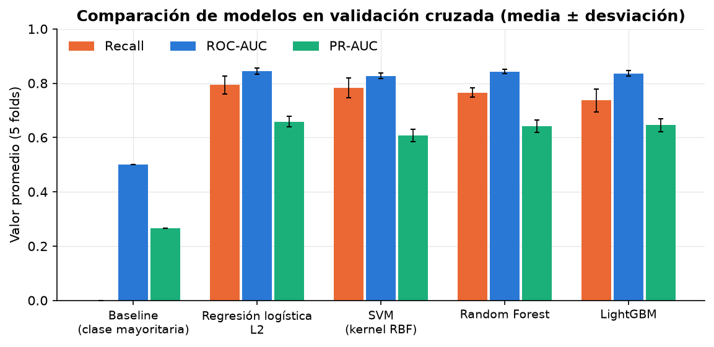
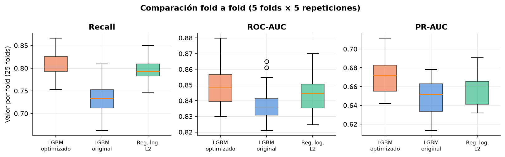
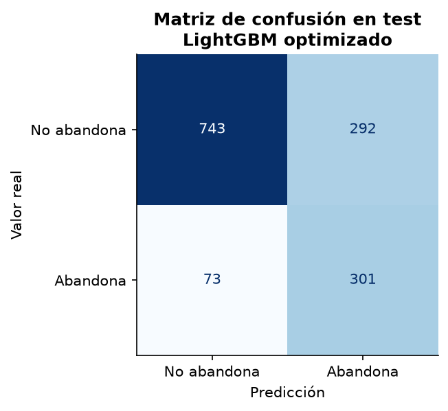
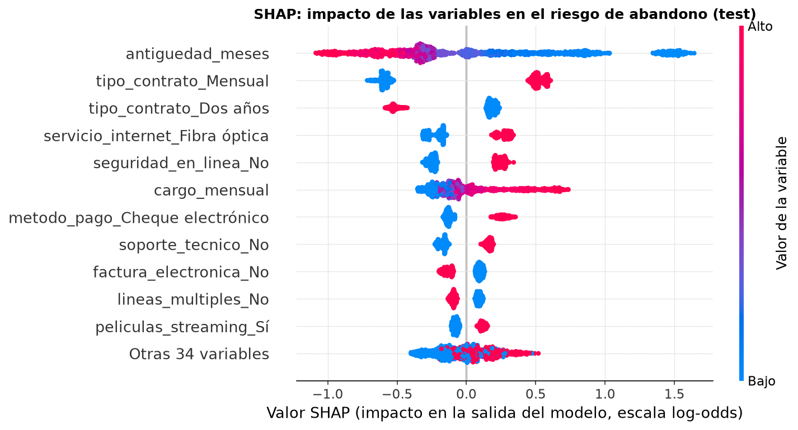
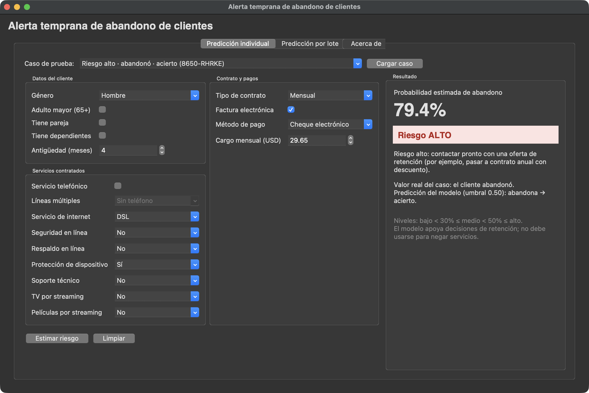
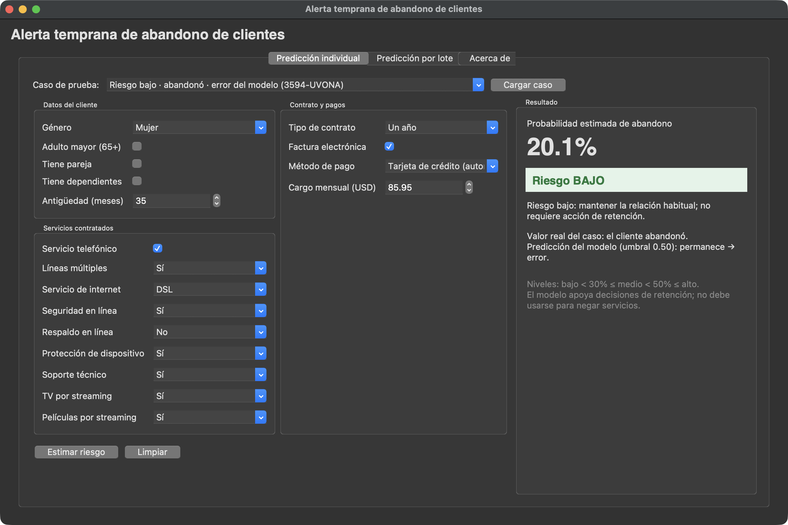
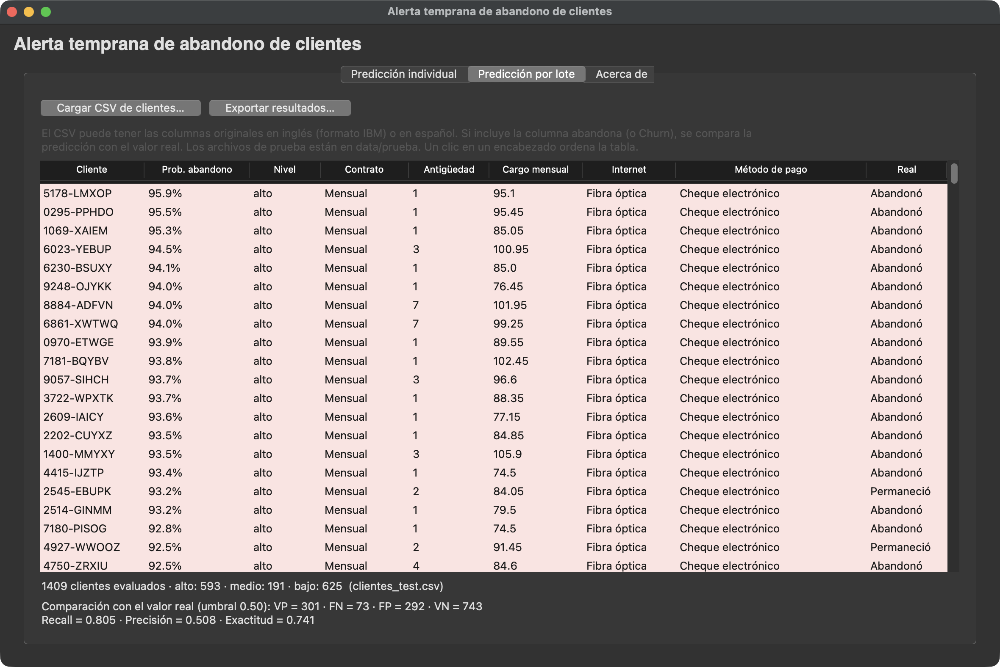
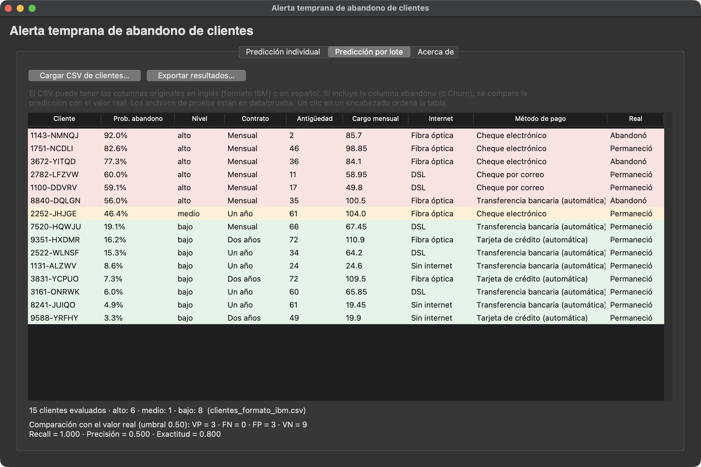
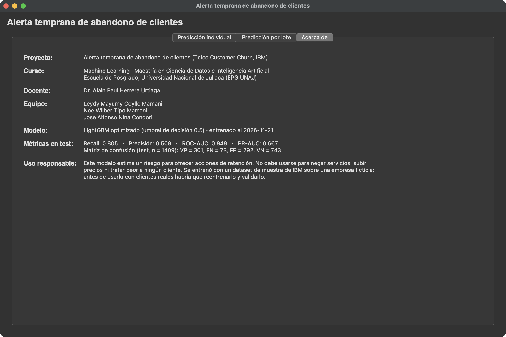

# Alerta temprana de abandono de clientes en telecomunicaciones

**Asignatura:** Machine Learning
**Programa:** Maestría en Ciencia de Datos e Inteligencia Artificial
**Institución:** Escuela de Posgrado, Universidad Nacional de Juliaca (EPG UNAJ)
**Docente:** Dr. Alain Paul Herrera Urtiaga

**Integrantes:**

- Leydy Mayumy Coyllo Mamani
- Noe Wilber Tipo Mamani
- Jose Alfonso Nina Condori

**Entregables:**

| Código | Práctica | Contenido | Documento |
|---|---|---|---|
| **P1** | Práctica 1 | Análisis exploratorio, preprocesamiento sin fuga de datos y comparación de cinco modelos supervisados | [Informe técnico](informe/P1_Informe_Tecnico.md) ([PDF](informe/P1_Informe_Tecnico.pdf)) |
| **P2** | Práctica 2 | Optimización de hiperparámetros, aprendizaje no supervisado, red neuronal, interpretación, sesgo y aplicación | [Artículo](informe/P2_Articulo.md) ([PDF](informe/P2_Articulo.pdf)) |

---

## Resumen

Se desarrolla un sistema de alerta temprana para identificar a los clientes de una empresa de telecomunicaciones con mayor probabilidad de cancelar su servicio. Se utiliza el conjunto público *Telco Customer Churn* de IBM (7 043 clientes, tasa de abandono del 26.5 %). En la P1 se compararon cinco modelos mediante validación cruzada estratificada; la regresión logística con regularización L2 obtuvo el mejor recall (0.793 ± 0.033). En la P2 se optimizó LightGBM con Optuna. Mediante validación cruzada repetida 5 × 5 y la prueba de rangos con signo de Wilcoxon, se verificó que supera a la regresión logística en recall (+0.013; 19 de 25 particiones; p = 0.0014). Sobre el conjunto de prueba, el modelo final alcanza un recall de 0.805, una precisión de 0.508, un ROC-AUC de 0.848 y un PR-AUC de 0.667: detecta 301 de los 374 clientes que abandonan. El análisis de interpretabilidad identifica la antigüedad y el tipo de contrato como los factores determinantes. El modelo se integró en una aplicación de escritorio (tkinter), validada funcionalmente con datos de prueba no utilizados en el entrenamiento.

**Palabras clave:** abandono de clientes, clasificación desbalanceada, LightGBM, Optuna, prueba de Wilcoxon, SHAP.

---

## 1. Planteamiento del problema

La retención de clientes resulta, en general, menos costosa que la captación de clientes nuevos. Por ello interesa anticipar qué clientes tienen mayor riesgo de abandono y dirigir hacia ellos las acciones de retención.

**Pregunta de investigación.** A partir de la información disponible de un cliente, ¿es posible estimar si cancelará su servicio?

- **Tipo de problema:** clasificación binaria supervisada (abandona / no abandona).
- **Métrica principal: recall de la clase positiva.** Un falso negativo implica perder los ingresos futuros del cliente; un falso positivo solo supone el costo de una oferta de retención.
- **Métricas complementarias:** ROC-AUC y PR-AUC, más informativa con clases desbalanceadas (Saito y Rehmsmeier, 2015).

## 2. Datos

*Telco Customer Churn* (IBM, 2019): 7 043 clientes de una empresa ficticia y 21 variables (demográficas, antigüedad, servicios contratados, contrato, forma de pago y cargos). Abandonan 1 869 clientes (26.5 %). Las variables se tradujeron al español sin modificar el archivo original. La descripción de la fuente, la licencia y el diccionario de variables están en [`data/README.md`](data/README.md).

| Decisión sobre los datos | Justificación |
|---|---|
| Exclusión de `cargo_total` | Correlación de 0.9996 con `antiguedad_meses × cargo_mensual`; redundante, sin mejora consistente al incluirla |
| Exclusión de `id_cliente` | Identificador sin contenido predictivo |
| Imputación dentro del Pipeline | Los 11 valores faltantes se imputan con estadísticos del conjunto de entrenamiento |
| Partición 80/20 estratificada | 5 634 clientes de entrenamiento y 1 409 de prueba, semilla 42 |

## 3. Metodología

**P1.** Análisis exploratorio con cinco hallazgos cuantificados. Preprocesamiento (imputación, estandarización y codificación *one-hot*) encapsulado en un `Pipeline` con `ColumnTransformer`. Se compararon cinco modelos con validación cruzada estratificada de 5 particiones: línea base de clase mayoritaria, regresión logística L2, SVM con kernel RBF, Random Forest y LightGBM. El desbalance se trató con `class_weight="balanced"`. El conjunto de prueba se utilizó una sola vez.

**P2.**

1. Optimización de LightGBM con Optuna (40 ensayos, muestreador TPE, objetivo PR-AUC).
2. Comparación del modelo optimizado, el original y la regresión logística sobre las mismas 25 particiones (`RepeatedStratifiedKFold` 5 × 5), con prueba de Wilcoxon. La regla de decisión se fijó antes de ver los resultados.
3. Segmentación no supervisada con k-means y proyección PCA.
4. Red neuronal multicapa (MLP) evaluada con el mismo protocolo.
5. Interpretación mediante importancia por permutación y valores SHAP.
6. Análisis de sesgo por género y edad.
7. Entrenamiento del modelo final y despliegue en una aplicación.

El detalle de cada decisión se documenta en [`DECISIONES.md`](DECISIONES.md).

## 4. Resultados

### 4.1 Comparación de modelos (P1, validación cruzada de 5 particiones)

| Modelo | Recall | Precisión | ROC-AUC | PR-AUC | Exactitud |
|---|---|---|---|---|---|
| Línea base (clase mayoritaria) | 0.000 | 0.000 | 0.500 | 0.265 | 0.735 |
| **Regresión logística L2** | **0.793 ± 0.033** | 0.519 | **0.845** | **0.658** | 0.750 |
| SVM (kernel RBF) | 0.783 ± 0.037 | 0.519 | 0.827 | 0.608 | 0.750 |
| Random Forest | 0.766 ± 0.017 | 0.534 | 0.843 | 0.642 | 0.761 |
| LightGBM (parámetros por defecto) | 0.737 ± 0.042 | 0.545 | 0.837 | 0.646 | 0.767 |

*Fuente: `resultados/02_comparacion_modelos.csv`.* La línea base alcanza una exactitud del 73.5 % sin detectar ningún abandono, lo que justifica el uso del recall como métrica principal. En el conjunto de prueba, la regresión logística obtuvo un recall de 0.773, un ROC-AUC de 0.839 y un PR-AUC de 0.628 (289 verdaderos positivos, 85 falsos negativos y 282 falsos positivos).



### 4.2 Optimización y contraste estadístico (P2, validación cruzada 5 × 5)

| Modelo | Recall | Precisión | ROC-AUC | PR-AUC |
|---|---|---|---|---|
| **LightGBM optimizado** | **0.809 ± 0.028** | 0.522 | **0.850** | **0.670** |
| Regresión logística L2 | 0.796 ± 0.027 | 0.521 | 0.845 | 0.657 |
| Red neuronal (MLP 32-16) | 0.789 ± 0.034 | 0.518 | 0.838 | 0.641 |
| LightGBM original | 0.736 ± 0.030 | 0.542 | 0.837 | 0.649 |

| Comparación (recall) | Diferencia media | Particiones ganadas | p (Wilcoxon) |
|---|---|---|---|
| LightGBM optimizado vs. LightGBM original | +0.073 | 25 de 25 | < 0.001 |
| LightGBM optimizado vs. regresión logística | +0.013 | 19 de 25 | 0.0014 |
| Red neuronal vs. regresión logística | −0.007 | 10 de 25 | 0.097 |
| Red neuronal vs. LightGBM optimizado | −0.020 | 4 de 25 | 0.0012 |

*Fuentes: `resultados/03_resumen_comparacion.csv`, `03_wilcoxon.csv`, `04_red_vs_modelos.csv`, `04_wilcoxon_red.csv`.*

El modelo optimizado cumple la regla de decisión fijada antes del experimento: mejora en recall con p < 0.05 y no empeora el PR-AUC. Por tanto, se adopta como modelo final. La mejora es estadísticamente significativa pero de magnitud reducida. El valor p debe leerse con cautela: las particiones no son independientes (Nadeau y Bengio, 2003) y los hiperparámetros se ajustaron con los mismos datos. La red neuronal no aporta mejoras.



### 4.3 Desempeño del modelo final en el conjunto de prueba

Modelo: LightGBM (600 árboles, profundidad máxima 2, tasa de aprendizaje 0.019, `class_weight="balanced"`), umbral de decisión 0.50. Ficha completa en `resultados/modelo_final.json`.

| Métrica | Valor |
|---|---|
| Recall | **0.805** |
| Precisión | 0.508 |
| F1 | 0.623 |
| ROC-AUC | 0.848 |
| PR-AUC | 0.667 |
| Exactitud | 0.741 |

| | Predicción: permanece | Predicción: abandona |
|---|---|---|
| **Real: permanece** (1 035) | VN = 743 | FP = 292 |
| **Real: abandona** (374) | FN = 73 | **VP = 301** |

El modelo identifica 301 de los 374 clientes que abandonan, 12 más que la regresión logística de la P1. Aproximadamente la mitad de las alertas corresponde a clientes que efectivamente se van. Las métricas de prueba son cercanas a las de validación cruzada (recall 0.805 frente a 0.809), sin indicios de sobreajuste.



**Sensibilidad al umbral de decisión** (validación cruzada, `resultados/03_umbral.csv`):

| Umbral | Recall | Precisión | Clientes alertados |
|---|---|---|---|
| 0.30 | 0.911 | 0.436 | 55.4 % |
| 0.40 | 0.867 | 0.479 | 48.1 % |
| **0.50** | **0.807** | **0.521** | **41.1 %** |
| 0.60 | 0.706 | 0.580 | 32.3 % |
| 0.70 | 0.589 | 0.647 | 24.1 % |

Se mantiene el umbral de 0.50. Un valor menor aumenta el recall a costa de alertar a una proporción mayor de clientes, y la elección óptima depende de la capacidad de retención de la empresa, dato no disponible.

### 4.4 Interpretación del modelo

| Variable | Caída de ROC-AUC al permutarla |
|---|---|
| Antigüedad (meses) | 0.079 |
| Tipo de contrato | 0.060 |
| Servicio de internet | 0.009 |
| Seguridad en línea | 0.005 |
| Cargo mensual | 0.004 |

*Fuente: `resultados/05_importancia_permutacion.csv`.* Los valores SHAP coinciden con la importancia por permutación: la baja antigüedad y el contrato mensual incrementan el riesgo, mientras que el contrato a dos años lo reduce. El género no tiene influencia apreciable.



### 4.5 Segmentación no supervisada (k-means, k = 3)

| Perfil | Proporción de clientes | Tasa de abandono |
|---|---|---|
| Nuevos con contrato mensual | 42.8 % | **45.4 %** |
| Leales con muchos servicios | 35.6 % | 15.6 % |
| Sin internet (bajo costo) | 21.5 % | 7.2 % |

La segmentación se realizó sin utilizar la variable objetivo; la tasa de abandono se calculó a posteriori (`resultados/04_perfiles.csv`).

### 4.6 Análisis de sesgo

| Grupo | Tasa real de abandono | Tasa de alertas | Recall | Precisión |
|---|---|---|---|---|
| Hombres | 25.1 % | 42.7 % | 0.818 | 0.481 |
| Mujeres | 28.1 % | 41.5 % | 0.793 | 0.537 |
| No adultos mayores | 23.3 % | 37.2 % | 0.765 | 0.479 |
| Adultos mayores | 44.1 % | 68.5 % | 0.918 | 0.592 |

No se observan diferencias relevantes por género. Los adultos mayores reciben más alertas. Esto se explica en parte por su mayor tasa real de abandono, pero la brecha en alertas supera a la brecha real. Por ello se recomienda emplear el modelo exclusivamente para ofrecer beneficios y supervisar su desempeño por grupo.

## 5. Validación funcional y pruebas

### 5.1 Datos de prueba

La carpeta [`data/prueba/`](data/prueba/README.md) contiene archivos listos para probar el modelo y la aplicación. Se generan con `scripts/generar_datos_prueba.py` a partir del conjunto de prueba, por lo que ninguno de esos clientes fue visto durante el entrenamiento.

| Archivo | Filas | Propósito |
|---|---|---|
| `clientes_test.csv` | 1 409 | Conjunto de prueba completo con la etiqueta real; reproduce las métricas oficiales |
| `clientes_muestra.csv` | 30 | Muestra estratificada para una prueba rápida |
| `clientes_formato_ibm.csv` | 15 | Columnas originales en inglés, para verificar la traducción automática |
| `casos_ejemplo.csv` | 8 | Casos individuales de riesgo bajo, medio y alto, con aciertos y errores del modelo |
| `error_*.csv` | 5 c/u | Archivos con un defecto cada uno, para verificar la validación de entradas |

### 5.2 Prueba de la aplicación de escritorio

Se ejecutó la aplicación tkinter (`app/app_escritorio.py`) con los archivos anteriores mediante `scripts/capturas_app.py`, que registra el resultado de cada escenario y captura la ventana. El registro completo, con las 17 capturas, está en [`docs/evidencias/prueba_app_escritorio.md`](docs/evidencias/prueba_app_escritorio.md).

| Escenario | Entrada | Resultado obtenido | Resultado esperado |
|---|---|---|---|
| Predicción por lote | `clientes_test.csv` (1 409) | VP = 301 · FN = 73 · FP = 292 · VN = 743; recall 0.805, precisión 0.508 | Idéntico a `modelo_final.json`; cumple |
| Predicción por lote | `clientes_muestra.csv` (30) | VP = 7 · FN = 1 · FP = 5 · VN = 17; recall 0.875 | Procesamiento sin error; cumple |
| Formato original de IBM | `clientes_formato_ibm.csv` (15) | Traducción automática; recall 1.000, exactitud 0.800 | Procesamiento sin error; cumple |
| Caso de riesgo bajo | 5893-PYOLZ | 8.6 %, riesgo bajo; el cliente permaneció | Acierto; cumple |
| Caso de riesgo alto | 8650-RHRKE | 79.4 %, riesgo alto; el cliente abandonó | Acierto; cumple |
| Falso negativo | 3594-UVONA | 20.1 %, riesgo bajo; el cliente abandonó | Error documentado del modelo |
| Coherencia del formulario | Internet = «Sin internet» | Servicios dependientes fijados en «Sin internet» | Cumple |
| Valor no numérico | `error_valor_no_numerico.csv` | «'antiguedad_meses' debe ser un número (filas: 2)» | Rechazo con mensaje; cumple |
| Categoría inválida | `error_categoria_invalida.csv` | «Valor no válido en 'tipo_contrato': 'Semanal'» | Rechazo con mensaje; cumple |
| Columna faltante | `error_columna_faltante.csv` | «Faltan columnas obligatorias: metodo_pago» | Rechazo con mensaje; cumple |

#### Capturas de la aplicación

**Figura 1.** Predicción individual de un caso de prueba de riesgo bajo (cliente 5893-PYOLZ). El panel de resultado muestra la probabilidad estimada (8.6 %), el nivel de riesgo, la recomendación y la comparación con el valor real.


**Figura 2.** Caso de riesgo alto (cliente 8650-RHRKE, 79.4 %). Al no contar con servicio telefónico, el campo *Líneas múltiples* queda fijado en «Sin teléfono».



**Figura 3.** Falso negativo documentado (cliente 3594-UVONA): el modelo estima 20.1 % y el cliente abandonó.



**Figura 4.** Predicción por lote sobre los 1 409 clientes del conjunto de prueba. La tabla se ordena por probabilidad y la comparación con el valor real reproduce la matriz de confusión oficial (VP = 301, FN = 73, FP = 292, VN = 743; recall 0.805).



**Figura 5.** Archivo en el formato original de IBM (columnas en inglés), traducido automáticamente por la aplicación.



**Figura 6.** Validación de entradas: el archivo sin la columna `metodo_pago` se rechaza con un mensaje explícito y la aplicación permanece abierta.


**Figura 7.** Pestaña de información del modelo, con las métricas de test leídas de `resultados/modelo_final.json`.



### 5.3 Pruebas automatizadas (pytest)

| Módulo de prueba | Pruebas | Qué verifica |
|---|---|---|
| `test_datos.py` | 8 | Integridad del CSV (SHA-256), traducción y tipos |
| `test_preprocesamiento.py` | 4 | Ausencia de fuga de datos en el Pipeline |
| `test_modelo.py` | 5 | Carga del modelo y coherencia con la ficha |
| `test_prediccion.py` | 13 | Predicción individual y por lote, validación de entradas |
| `test_datos_prueba.py` | 9 | Reproducción de métricas oficiales con `data/prueba/` y rechazo de archivos defectuosos |
| `test_apps.py` | 3 | Aplicación tkinter (prueba de humo en ventana real) y demostración Streamlit |
| `test_notebooks.py` | 2 | Ejecución completa de los cinco notebooks y coincidencia de métricas |
| `test_reproducibilidad.py` | 1 | Dos entrenamientos consecutivos producen métricas idénticas |

La salida de la última ejecución está en [`docs/evidencias/pytest.txt`](docs/evidencias/pytest.txt).

## 6. Reproducibilidad

```bash
# Entorno (Python 3.11 o superior con tkinter; se usó 3.13.5)
python3 -m venv .venv
source .venv/bin/activate              # Windows: .venv\Scripts\activate
pip install -r requirements.txt

# Notebooks, en orden
cd notebooks
for n in 01_eda 02_modelos 03_optimizacion 04_no_supervisado_y_red 05_interpretacion; do
  jupyter nbconvert --to notebook --execute --inplace $n.ipynb
done
cd ..

python scripts/entrenar.py               # reentrena el modelo final
python scripts/generar_datos_prueba.py   # regenera data/prueba/
pytest                                   # batería completa (≈ 1.5 min)
pytest -m "not lento"                    # solo pruebas rápidas

python app/app_escritorio.py             # aplicación de escritorio
python scripts/capturas_app.py           # prueba funcional de la aplicación
streamlit run app/app.py                 # demostración web
```

Los notebooks pueden ejecutarse también en Google Colab: cada uno descarga los datos desde la URL pública si no los encuentra localmente. El uso de la aplicación se describe en [`docs/MANUAL_APP.md`](docs/MANUAL_APP.md).

## 7. Estructura del repositorio

```
├── data/                 Datos originales de IBM y datos de prueba (data/prueba/)
├── src/churn/            Código compartido: carga, preprocesamiento y predicción
├── notebooks/            01 EDA · 02 modelos (P1) · 03 optimización · 04 no supervisado y red · 05 interpretación (P2)
├── resultados/           Tablas (.csv, .json) y figuras generadas por los notebooks
├── scripts/              Entrenamiento, generación de datos de prueba y prueba funcional de la app
├── app/                  Aplicación de escritorio (tkinter), demostración Streamlit y modelo serializado
├── informe/              P1 (informe técnico) y P2 (artículo) en Markdown y PDF
├── docs/                 Manual de la aplicación, guía de sustentación y evidencias de prueba
├── tests/                Pruebas automatizadas (pytest)
├── DECISIONES.md         Registro de decisiones metodológicas
└── REQUISITOS.md         Matriz de cumplimiento de requisitos
```

## 8. Limitaciones

- El conjunto de datos corresponde a una empresa ficticia y a un único corte temporal.
- Las relaciones identificadas son asociaciones, no efectos causales.
- El modelo no incorpora el valor económico de cada cliente ni el costo de las acciones de retención.
- La mejora frente a la regresión logística es reducida.
- Existe una brecha en la tasa de alertas entre adultos mayores y el resto de clientes.

El análisis completo figura en la sección 6 del [artículo de la P2](informe/P2_Articulo.md).

## 9. Uso de herramientas de inteligencia artificial

En la elaboración de este trabajo se emplearon herramientas de inteligencia artificial generativa como apoyo en la escritura de código y en la redacción de borradores. Los resultados numéricos proceden de la ejecución de los notebooks del repositorio y fueron verificados por el equipo, que asume la responsabilidad del contenido.

## Referencias

Akiba, T., Sano, S., Yanase, T., Ohta, T., & Koyama, M. (2019). Optuna: A next-generation hyperparameter optimization framework. En *Proceedings of the 25th ACM SIGKDD International Conference on Knowledge Discovery & Data Mining* (pp. 2623–2631). https://doi.org/10.1145/3292500.3330701

IBM. (2019). *Telco customer churn on ICP4D* [Repositorio de GitHub]. https://github.com/IBM/telco-customer-churn-on-icp4d

Ke, G., Meng, Q., Finley, T., Wang, T., Chen, W., Ma, W., Ye, Q., & Liu, T.-Y. (2017). LightGBM: A highly efficient gradient boosting decision tree. En *Advances in Neural Information Processing Systems 30* (pp. 3146–3154).

Lundberg, S. M., & Lee, S.-I. (2017). A unified approach to interpreting model predictions. En *Advances in Neural Information Processing Systems 30* (pp. 4765–4774).

Nadeau, C., & Bengio, Y. (2003). Inference for the generalization error. *Machine Learning, 52*(3), 239–281.

Pedregosa, F., et al. (2011). Scikit-learn: Machine learning in Python. *Journal of Machine Learning Research, 12*, 2825–2830.

Saito, T., & Rehmsmeier, M. (2015). The precision-recall plot is more informative than the ROC plot when evaluating binary classifiers on imbalanced datasets. *PLOS ONE, 10*(3), e0118432. https://doi.org/10.1371/journal.pone.0118432

Wilcoxon, F. (1945). Individual comparisons by ranking methods. *Biometrics Bulletin, 1*(6), 80–83. https://doi.org/10.2307/3001968
