# Prueba funcional de la aplicación de escritorio

Fecha de ejecución: 2026-11-21 · Python 3.13.5 · Darwin 25.3.0

Generado por `scripts/capturas_app.py`, que abre la aplicación tkinter y ejecuta cada escenario con los archivos de `data/prueba/`.

| # | Escenario | Entrada | Resultado mostrado en la interfaz | Captura |
|---|---|---|---|---|
| 1 | Predicción individual con valores iniciales | Formulario por defecto | Probabilidad 59.0%; Riesgo ALTO | 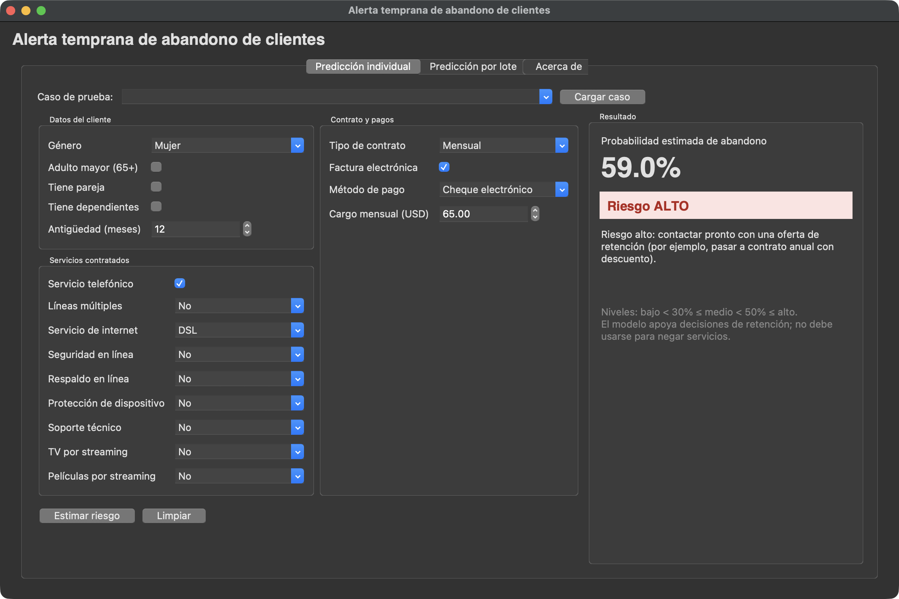 |
| 2 | Caso de prueba | Riesgo bajo · permaneció · acierto (5893-PYOLZ) | Probabilidad 8.6%; Riesgo BAJO. Valor real del caso: el cliente permaneció. Predicción del modelo (umbral 0.50): permanece → acierto. |  |
| 3 | Caso de prueba | Riesgo bajo · abandonó · error del modelo (3594-UVONA) | Probabilidad 20.1%; Riesgo BAJO. Valor real del caso: el cliente abandonó. Predicción del modelo (umbral 0.50): permanece → error. | 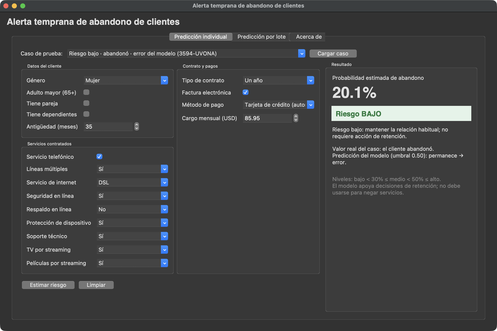 |
| 4 | Caso de prueba | Riesgo medio · permaneció · acierto (8713-IGZSO) | Probabilidad 37.9%; Riesgo MEDIO. Valor real del caso: el cliente permaneció. Predicción del modelo (umbral 0.50): permanece → acierto. | 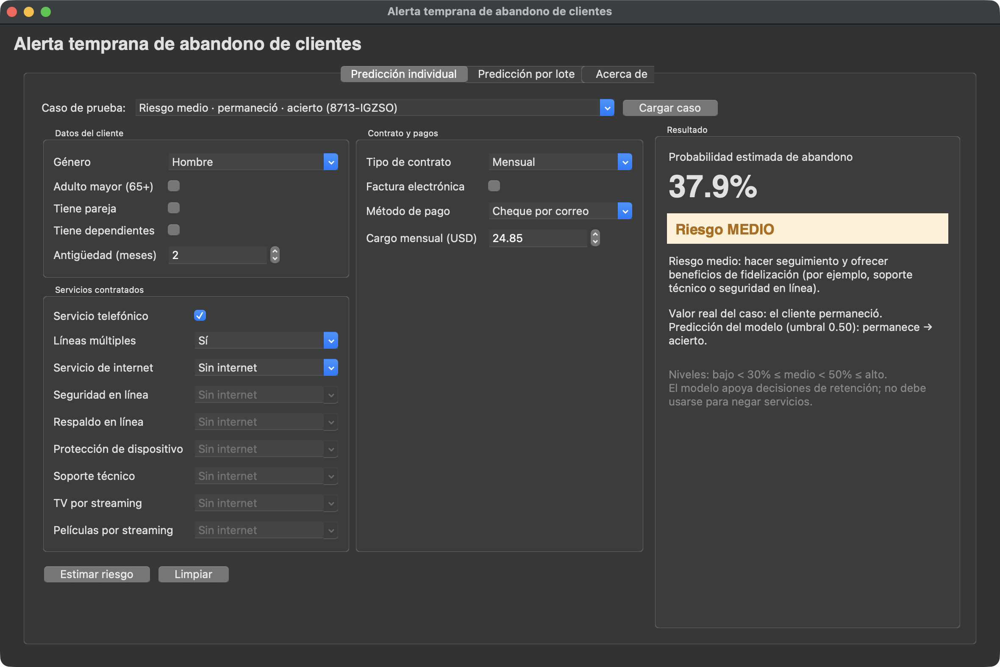 |
| 5 | Caso de prueba | Riesgo medio · abandonó · error del modelo (1087-UDSIH) | Probabilidad 38.4%; Riesgo MEDIO. Valor real del caso: el cliente abandonó. Predicción del modelo (umbral 0.50): permanece → error. |  |
| 6 | Caso de prueba | Riesgo alto · permaneció · error del modelo (9450-TRJUU) | Probabilidad 67.4%; Riesgo ALTO. Valor real del caso: el cliente permaneció. Predicción del modelo (umbral 0.50): abandona → error. | 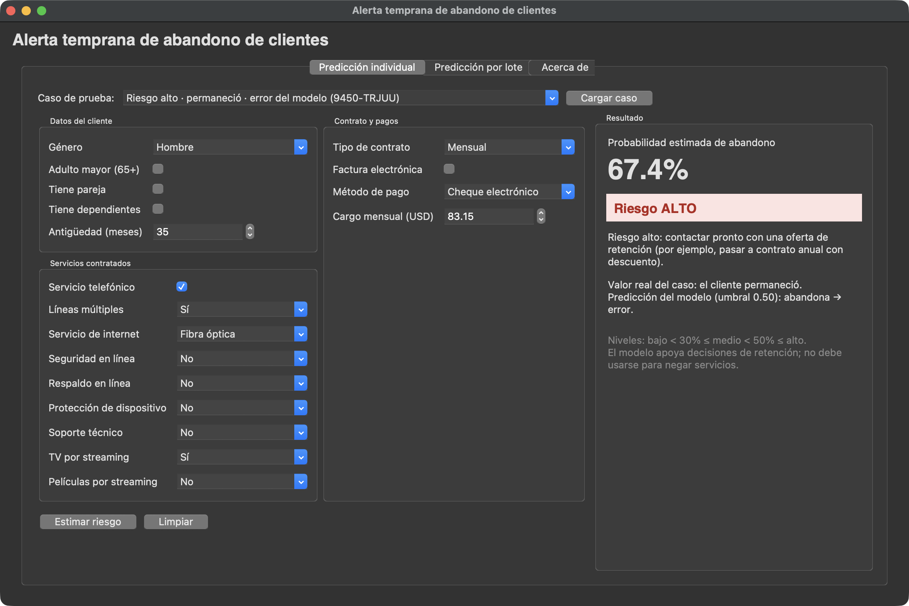 |
| 7 | Caso de prueba | Riesgo alto · abandonó · acierto (8650-RHRKE) | Probabilidad 79.4%; Riesgo ALTO. Valor real del caso: el cliente abandonó. Predicción del modelo (umbral 0.50): abandona → acierto. |  |
| 8 | Caso de prueba | Riesgo medio · abandonó · error del modelo (7957-RYHQD) | Probabilidad 49.9%; Riesgo MEDIO. Valor real del caso: el cliente abandonó. Predicción del modelo (umbral 0.50): permanece → error. | 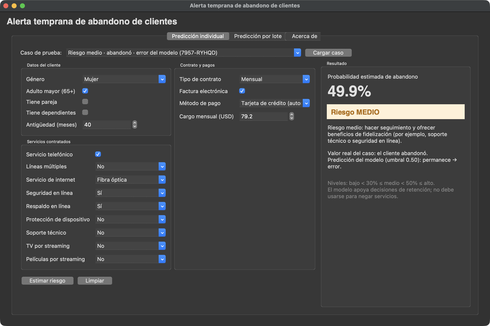 |
| 9 | Caso de prueba | Riesgo alto · permaneció · error del modelo (8495-PRWFH) | Probabilidad 50.2%; Riesgo ALTO. Valor real del caso: el cliente permaneció. Predicción del modelo (umbral 0.50): abandona → error. |  |
| 10 | Coherencia del formulario | Servicio de internet = Sin internet | Servicios dependientes fijados en: Sin internet | 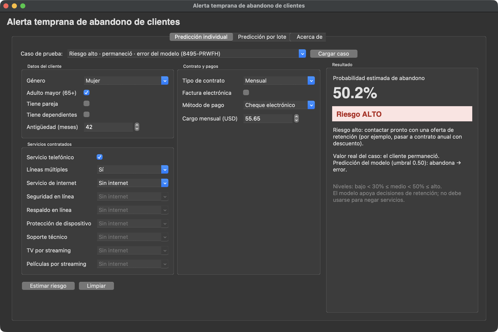 |
| 11 | Predicción por lote | clientes_test.csv | 1409 clientes evaluados · alto: 593 · medio: 191 · bajo: 625  (clientes_test.csv). Comparación con el valor real (umbral 0.50): VP = 301 · FN = 73 · FP = 292 · VN = 743 Recall = 0.805 · Precisión = 0.508 · Exactitud = 0.741 | 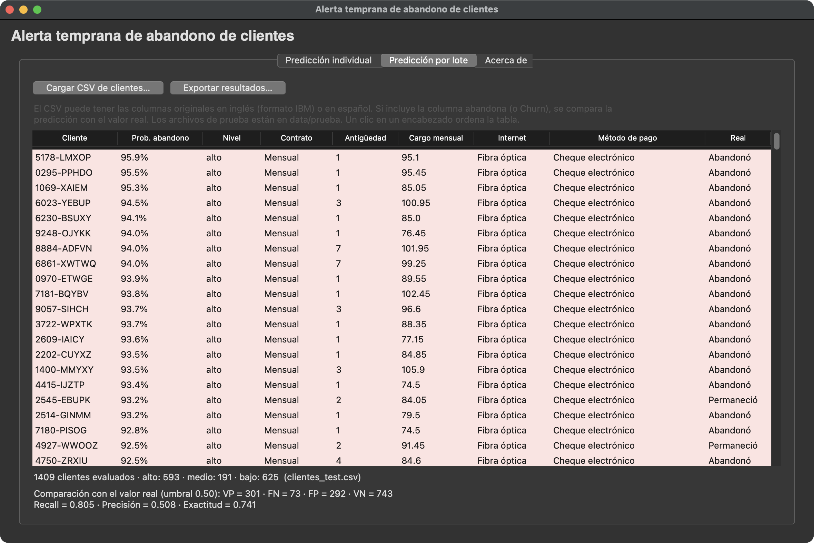 |
| 12 | Predicción por lote | clientes_muestra.csv | 30 clientes evaluados · alto: 12 · medio: 5 · bajo: 13  (clientes_muestra.csv). Comparación con el valor real (umbral 0.50): VP = 7 · FN = 1 · FP = 5 · VN = 17 Recall = 0.875 · Precisión = 0.583 · Exactitud = 0.800 | 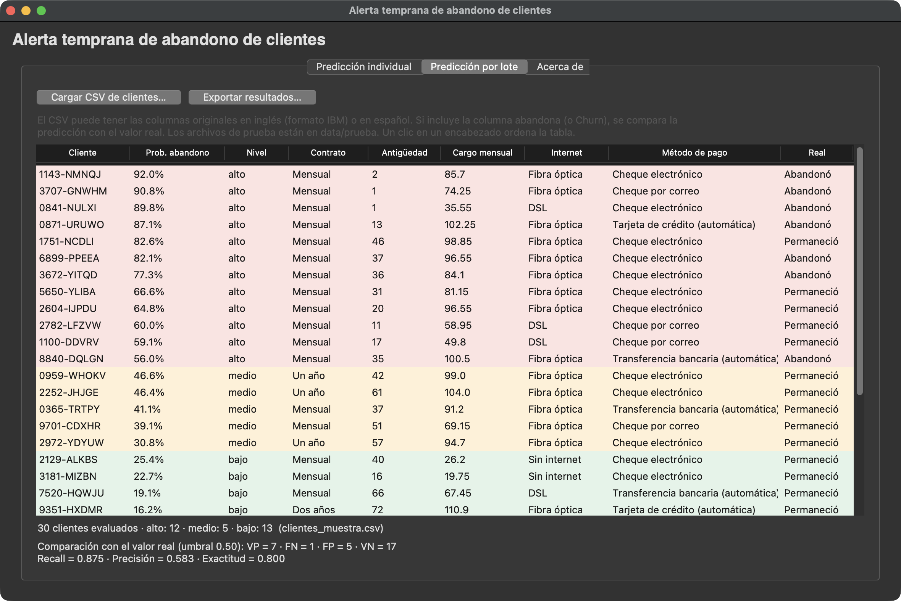 |
| 13 | Predicción por lote | clientes_formato_ibm.csv | 15 clientes evaluados · alto: 6 · medio: 1 · bajo: 8  (clientes_formato_ibm.csv). Comparación con el valor real (umbral 0.50): VP = 3 · FN = 0 · FP = 3 · VN = 9 Recall = 1.000 · Precisión = 0.500 · Exactitud = 0.800 | 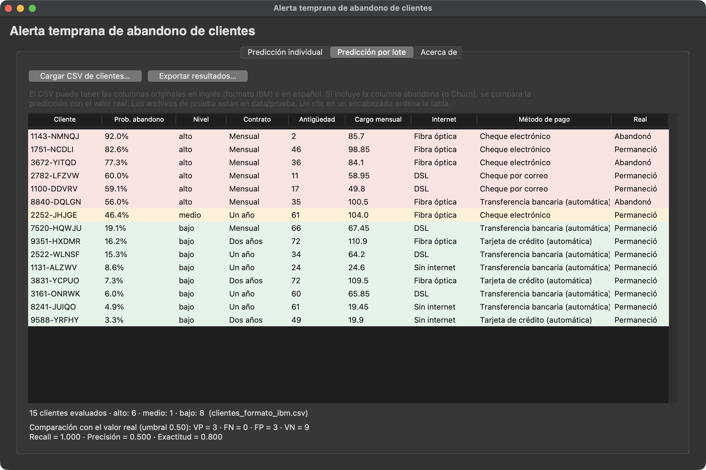 |
| 14 | Validación de entradas | error_valor_no_numerico.csv | Archivo no válido: 'antiguedad_meses' debe ser un número (filas: 2). | 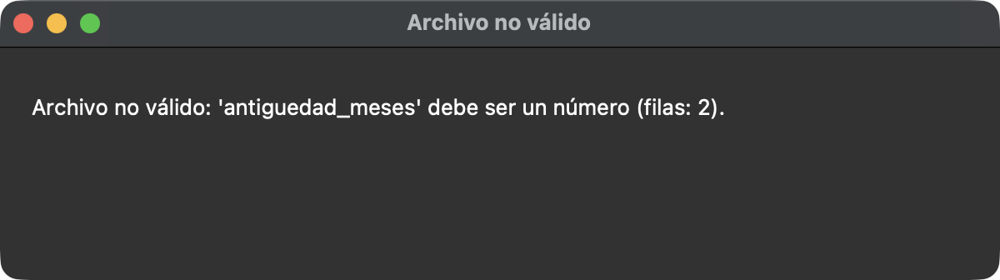 |
| 15 | Validación de entradas | error_categoria_invalida.csv | Archivo no válido: Valor no válido en 'tipo_contrato': 'Semanal'. Opciones: Dos años, Mensual, Un año | 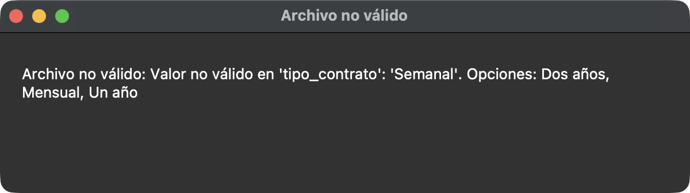 |
| 16 | Validación de entradas | error_columna_faltante.csv | Archivo no válido: Faltan columnas obligatorias: metodo_pago | 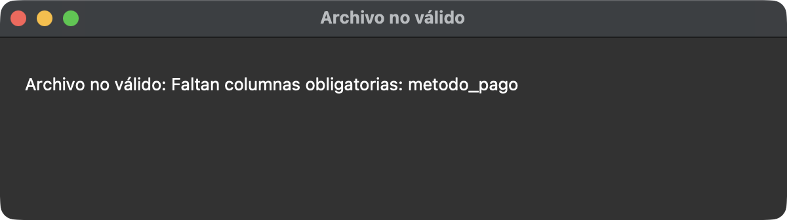 |
| 17 | Información del modelo | Pestaña «Acerca de» | Muestra modelo, umbral, fecha y métricas de test | 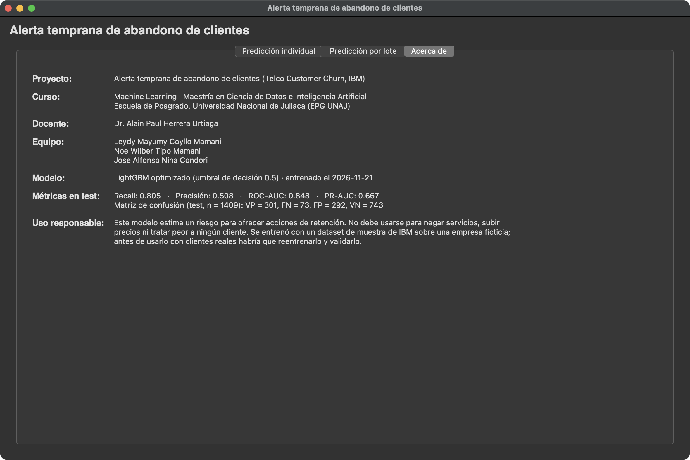 |
