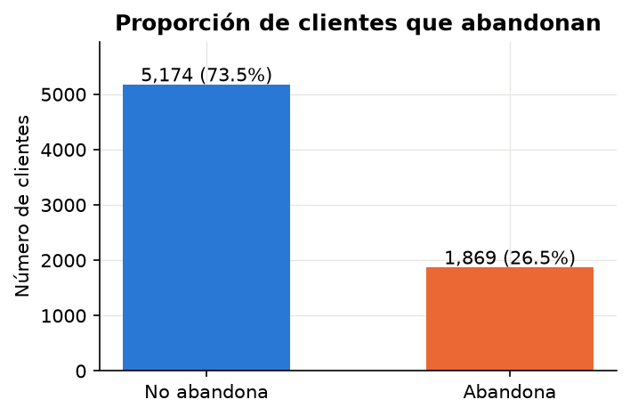
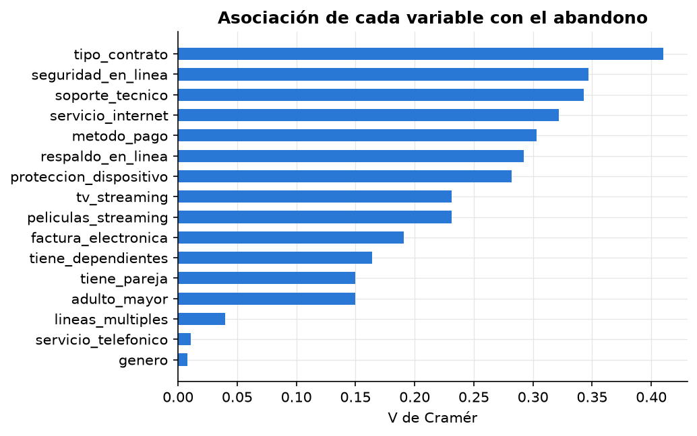
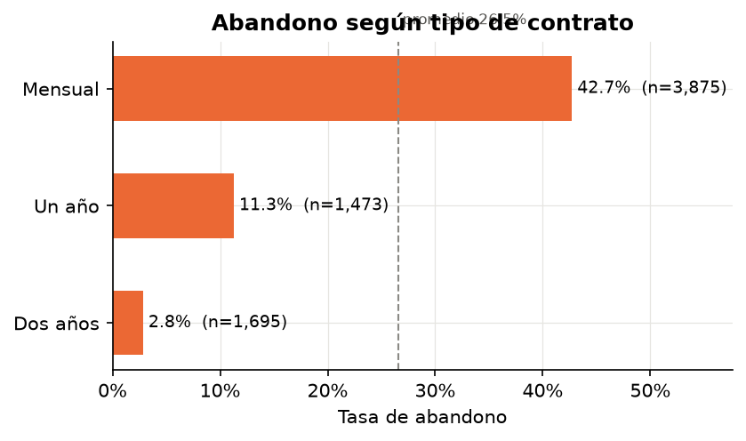
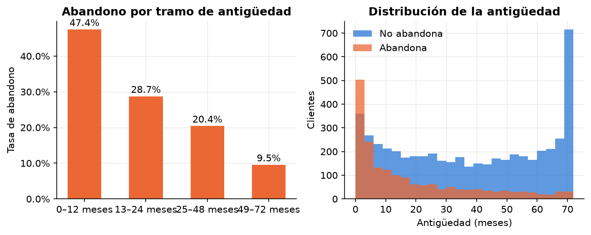
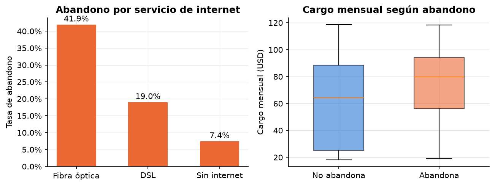
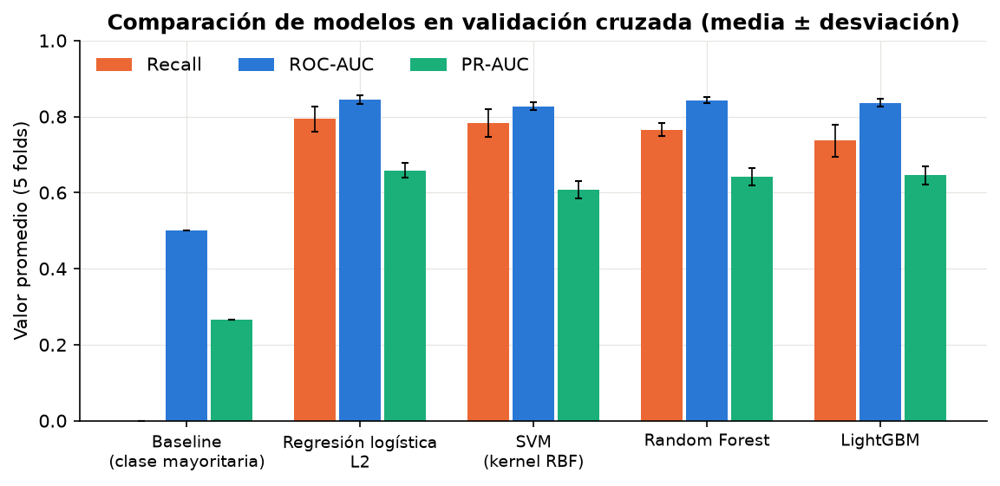
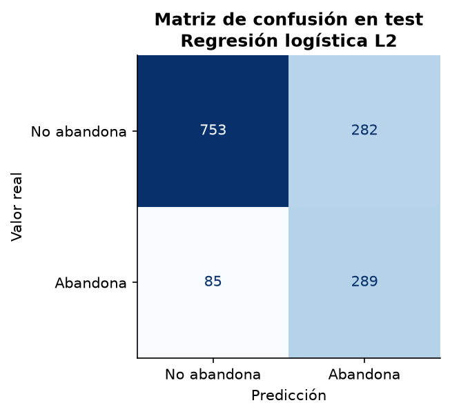

# Alerta temprana de abandono de clientes en una empresa de telecomunicaciones

**Producto 1 · Informe técnico**

**Curso:** Machine Learning · Maestría en Ciencia de Datos e Inteligencia Artificial
**Institución:** Escuela de Posgrado, Universidad Nacional de Juliaca (EPG UNAJ)
**Docente:** Dr. Alain Paul Herrera Urtiaga
**Autores:** Leydy Mayumy Coyllo Mamani · Noe Wilber Tipo Mamani · Jose Alfonso Nina Condori
**Repositorio:** notebooks `01_eda.ipynb` y `02_modelos.ipynb`; tablas en `resultados/`.

---

## 1. Problema y contexto

Las empresas de telecomunicaciones pierden cada mes una parte de sus clientes, que cancelan el servicio para irse a la competencia o simplemente dejar de usarlo. A este fenómeno se le llama **abandono** (en inglés, *churn*). Conseguir un cliente nuevo suele costar más que conservar uno existente, por lo que a la empresa le interesa **detectar a tiempo** a los clientes que están por irse y ofrecerles algo para que se queden (un descuento, un cambio de plan, soporte técnico).

**Pregunta del proyecto:** con los datos actuales de un cliente, ¿qué clientes cancelarán su servicio?

Se trata de un problema de **clasificación binaria supervisada**: para cada cliente, el modelo debe decir si abandona (1) o no (0), y con qué probabilidad. El resultado se usa como un sistema de **alerta temprana** que prioriza a quién contactar.

## 2. Datos y hallazgos

### 2.1 Los datos

Usamos el dataset **Telco Customer Churn**, publicado por IBM como dataset de muestra sobre una empresa de telecomunicaciones ficticia (IBM, 2019). Tiene **7 043 clientes y 21 columnas**: datos demográficos (género, adulto mayor, pareja, dependientes), antigüedad, servicios contratados (teléfono, internet y sus complementos), contrato y forma de pago, cargos mensual y total, y la variable objetivo `Churn` (si el cliente se fue en el último mes). Renombramos todas las columnas y categorías al español (diccionario en `data/README.md`).

Calidad de los datos (`resultados/01_resumen_datos.json`):

- Solo hay **11 valores faltantes**, en `cargo_total`, que venía como texto con blancos; los 11 son clientes con **0 meses de antigüedad**, a quienes todavía no se les había facturado.
- No hay identificadores repetidos.
- **Abandonan 1 869 de 7 043 clientes (26.5 %)**. La clase de interés es minoritaria.

### 2.2 Hallazgos del análisis exploratorio

Para elegir los hallazgos con evidencia medimos la asociación de cada variable categórica con el abandono mediante la V de Cramér (`resultados/01_asociacion_variables.csv`). Las más asociadas son el tipo de contrato (0.41), la seguridad en línea (0.35), el soporte técnico (0.34), el servicio de internet (0.32) y el método de pago (0.30); el género no tiene asociación (0.008).

**Hallazgo 1 · El contrato mensual concentra el abandono.** Con contrato mensual abandona el **42.7 %**, con contrato de un año el **11.3 %** y con contrato de dos años solo el **2.8 %**.

**Hallazgo 2 · Los clientes nuevos se van más.** En el primer año abandona el **47.4 %**; entre quienes llevan 49 a 72 meses, el **9.5 %**. La mediana de antigüedad es de 10 meses entre quienes abandonan y de 38 entre quienes se quedan.

**Hallazgo 3 · Fibra óptica y cargos altos.** Con fibra óptica abandona el **41.9 %**, con DSL el 19.0 % y sin internet el 7.4 %. El cargo mensual mediano de quienes abandonan es 79.65 USD, frente a 64.43 USD de quienes se quedan.

**Hallazgo 4 · El cheque electrónico.** Quienes pagan con cheque electrónico abandonan el **45.3 %**, frente a 15.2 % (tarjeta automática), 16.7 % (transferencia automática) y 19.1 % (cheque por correo).

**Hallazgo 5 · Los servicios de protección se asocian a más fidelidad.** Sin soporte técnico abandona el 41.6 % y con él el 15.2 %; sin seguridad en línea, el 41.8 % frente al 14.6 %.

**Qué implican para el modelado:** la clase minoritaria obliga a usar métricas adecuadas y a estratificar; las variables de relación con la empresa (contrato, antigüedad, servicios, pago) deberían dominar al modelo; y las demográficas, en particular el género, aportan poco, aunque las conservamos para poder revisar sesgos en el Producto 2.

## 3. Métrica de éxito

La métrica principal es el **recall** de la clase "abandona": de todos los clientes que realmente se van, ¿qué proporción detecta el modelo?

La razón es el **costo de cada error**:

| Error | Qué significa | Costo para la empresa |
|---|---|---|
| Falso negativo | El cliente se iba y el modelo no avisó | Se pierde todo el ingreso futuro del cliente |
| Falso positivo | El modelo avisó, pero el cliente se iba a quedar | Una llamada o un descuento innecesario |

Como el primer error es mucho más caro que el segundo, preferimos un modelo que detecte a la mayoría de los que se van, aunque genere algunas alertas de más.

El recall por sí solo se puede "ganar" marcando a todos como riesgo, así que reportamos siempre también:

- **ROC-AUC:** capacidad de ordenar a los clientes de más a menos riesgo (0.5 = azar, 1 = perfecto).
- **PR-AUC (precisión media):** resume la relación entre precisión y recall; con una clase minoritaria es más informativa que ROC-AUC (Saito y Rehmsmeier, 2015).
- **Precisión:** de los clientes alertados, cuántos se iban de verdad.

No usamos la exactitud (*accuracy*): un modelo que diga "nadie abandona" acierta el 73.5 % y no detecta a nadie.

## 4. Preprocesamiento y cómo se evitó la fuga de datos

**División.** Separamos 80 % para entrenamiento (5 634 clientes) y 20 % para test (1 409), **estratificando** por la variable objetivo para mantener la misma proporción de abandono en ambos (26.5 %), con semilla 42. El test se guardó y se usó **una sola vez**, al final.

**Pipeline.** Todo el preprocesamiento está dentro de un `Pipeline` de scikit-learn (Pedregosa et al., 2011) con un `ColumnTransformer`:

- Numéricas (`antiguedad_meses`, `cargo_mensual`): imputación por la mediana y escalado estándar.
- Categóricas (16 variables): imputación por la moda y codificación *one-hot* con `handle_unknown="ignore"`, para que una categoría nueva no rompa el modelo.

**Por qué evita la fuga.** Hay fuga de datos cuando información del conjunto de evaluación se cuela en el entrenamiento (Kaufman et al., 2012), por ejemplo si se calcula la media para escalar con todas las filas antes de dividir. Con el Pipeline, en cada fold de la validación cruzada la mediana, la media, la desviación y las categorías se aprenden **solo con los folds de entrenamiento**, y se aplican a los de validación. Por la misma razón, la conversión de `cargo_total` a número se hace antes de dividir (no aprende nada de los datos), pero su imputación no.

**Variables excluidas.**

- `id_cliente`: es un identificador; no describe al cliente.
- `cargo_total`: tiene una correlación de **0.9996** con `antiguedad_meses × cargo_mensual`. No es fuga (se conoce al momento de predecir), pero es **redundante**. Lo comprobamos: añadirla cambia el recall de la regresión logística de 0.793 a 0.801 y el de LightGBM de 0.737 a 0.730, diferencias menores que la variación entre folds y en sentidos opuestos (`resultados/02_prueba_cargo_total.csv`). Decidimos excluirla.

## 5. Modelos comparados

Comparamos los cinco modelos obligatorios, todos dentro del mismo Pipeline y, salvo el baseline, con `class_weight="balanced"` para que los errores en la clase minoritaria pesen más:

1. **Baseline:** `DummyClassifier` que siempre predice la clase mayoritaria ("no abandona").
2. **Regresión logística L2** (C = 1).
3. **SVM con kernel RBF** (C = 1).
4. **Random Forest** (300 árboles, mínimo 5 observaciones por hoja).
5. **LightGBM** con parámetros por defecto (Ke et al., 2017).

Cada modelo se evaluó con **validación cruzada estratificada de 5 folds** sobre el entrenamiento, reportando media ± desviación estándar.

## 6. Resultados

### 6.1 Validación cruzada

| Modelo | Recall | Precisión | ROC-AUC | PR-AUC | Exactitud |
|---|---|---|---|---|---|
| Baseline (clase mayoritaria) | 0.000 ± 0.000 | 0.000 ± 0.000 | 0.500 ± 0.000 | 0.265 ± 0.000 | 0.735 ± 0.000 |
| **Regresión logística L2** | **0.793 ± 0.033** | 0.519 ± 0.018 | **0.845 ± 0.012** | **0.658 ± 0.019** | 0.750 ± 0.014 |
| SVM (kernel RBF) | 0.783 ± 0.037 | 0.519 ± 0.011 | 0.827 ± 0.010 | 0.608 ± 0.023 | 0.750 ± 0.009 |
| Random Forest | 0.766 ± 0.017 | 0.534 ± 0.015 | 0.843 ± 0.008 | 0.642 ± 0.022 | 0.761 ± 0.011 |
| LightGBM | 0.737 ± 0.042 | 0.545 ± 0.010 | 0.837 ± 0.010 | 0.646 ± 0.024 | 0.767 ± 0.008 |

*Fuente: `resultados/02_comparacion_modelos.csv`.*

**Lectura:**

- El baseline tiene la exactitud de 73.5 % pero recall 0: confirma que la exactitud engaña en este problema.
- Los cuatro modelos reales superan claramente al baseline (ROC-AUC 0.83–0.85 frente a 0.50).
- La regresión logística logra el mejor recall, ROC-AUC y PR-AUC. LightGBM sin ajustar es el más conservador: mayor precisión, menor recall.
- Las diferencias entre modelos son de pocas centésimas, del orden de una o dos desviaciones estándar.

### 6.2 Elección del mejor modelo

Fijamos la regla antes de mirar el test: gana el mayor recall medio; si varios están a menos de una desviación del líder, se desempata por PR-AUC y, después, por simplicidad. La regresión logística (0.793) y la SVM (0.783) quedan dentro de una desviación; la regresión logística tiene mayor PR-AUC (0.658 frente a 0.608) y es más simple e interpretable. **Mejor modelo: regresión logística L2.**

### 6.3 Evaluación única en el test

| Métrica | Valor en test |
|---|---|
| Recall | **0.773** |
| Precisión | 0.506 |
| ROC-AUC | 0.839 |
| PR-AUC | 0.628 |
| F1 | 0.612 |
| Exactitud | 0.740 |

*Fuente: `resultados/02_test_mejor_modelo.json`.*

De los **374 clientes del test que abandonaron, el modelo detecta 289** y no detecta 85. A cambio, genera **282 falsas alarmas** entre los 1 035 que se quedaron: aproximadamente la mitad de las alertas son correctas. Los valores del test están cerca de los de validación cruzada (recall 0.773 frente a 0.793 ± 0.033), así que no hay señales de sobreajuste. En términos de negocio: **de cada 100 clientes que se iban a ir, el modelo avisa a tiempo de unos 77**, a cambio de contactar a aproximadamente un cliente que se iba a quedar por cada uno que sí se iba.

## 7. Conclusiones

1. El abandono afecta al **26.5 %** de los clientes y se concentra en quienes tienen **contrato mensual** (42.7 %), son **nuevos** (47.4 % en el primer año), tienen **fibra óptica** (41.9 %), pagan con **cheque electrónico** (45.3 %) o no tienen **servicios de protección** (≈ 42 %).
2. Con un Pipeline que evita la fuga de datos, **la regresión logística L2 es el mejor modelo del Producto 1**: recall 0.793 en validación cruzada y **0.773 en el test**, con ROC-AUC 0.839.
3. La exactitud no sirve para este problema: el baseline obtiene 73.5 % sin detectar a nadie.
4. `cargo_total` se excluyó por ser redundante, no por fuga; la decisión está respaldada por una prueba con y sin la variable.
5. **Próximo paso (Producto 2):** optimizar el modelo de boosting, comprobar con una prueba estadística si mejora de verdad a la regresión logística, interpretar el modelo y revisar sesgos.

**Limitaciones.** Es un dataset de muestra de una empresa ficticia y una foto de un solo momento; el modelo no sabe *por qué* se va un cliente ni cuánto vale cada uno. Las relaciones encontradas son asociaciones, no causas.

## Uso de inteligencia artificial generativa

El código, los análisis y los borradores de este informe se generaron con herramientas de inteligencia artificial generativa a partir de las indicaciones del equipo. Todas las cifras provienen de la ejecución real de los notebooks del repositorio. El equipo es responsable de revisar, ejecutar y poder explicar todo el contenido antes de entregarlo.

## Referencias

IBM. (2019). *Telco customer churn on ICP4D* [Repositorio de GitHub; dataset Telco-Customer-Churn.csv]. https://github.com/IBM/telco-customer-churn-on-icp4d

Kaufman, S., Rosset, S., Perlich, C., & Stitelman, O. (2012). Leakage in data mining: Formulation, detection, and avoidance. *ACM Transactions on Knowledge Discovery from Data, 6*(4), Artículo 15. https://doi.org/10.1145/2382577.2382579 [VERIFICAR DOI]

Ke, G., Meng, Q., Finley, T., Wang, T., Chen, W., Ma, W., Ye, Q., & Liu, T.-Y. (2017). LightGBM: A highly efficient gradient boosting decision tree. En *Advances in Neural Information Processing Systems 30* (pp. 3146–3154).

Pedregosa, F., Varoquaux, G., Gramfort, A., Michel, V., Thirion, B., Grisel, O., Blondel, M., Prettenhofer, P., Weiss, R., Dubourg, V., Vanderplas, J., Passos, A., Cournapeau, D., Brucher, M., Perrot, M., & Duchesnay, É. (2011). Scikit-learn: Machine learning in Python. *Journal of Machine Learning Research, 12*, 2825–2830.

Saito, T., & Rehmsmeier, M. (2015). The precision-recall plot is more informative than the ROC plot when evaluating binary classifiers on imbalanced datasets. *PLOS ONE, 10*(3), e0118432. https://doi.org/10.1371/journal.pone.0118432
