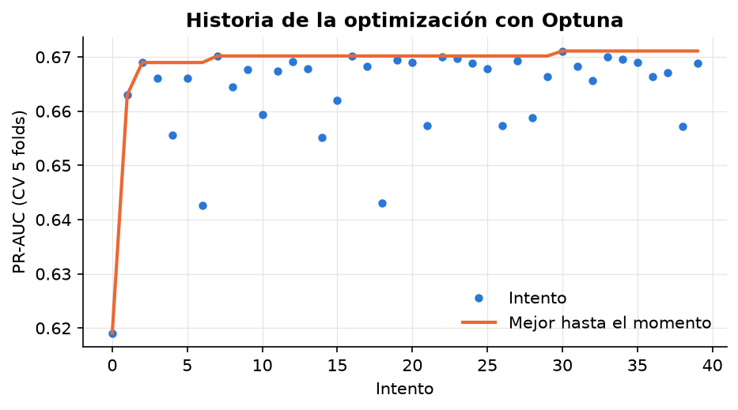
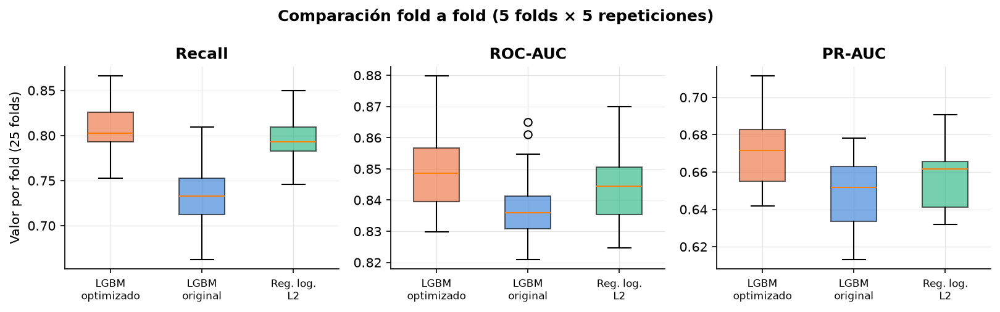
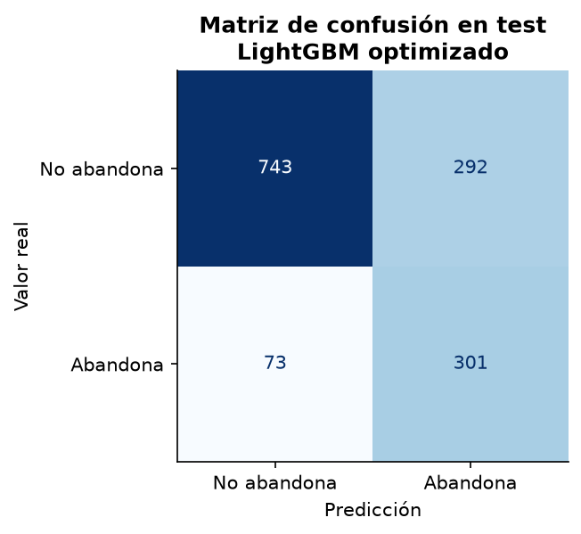
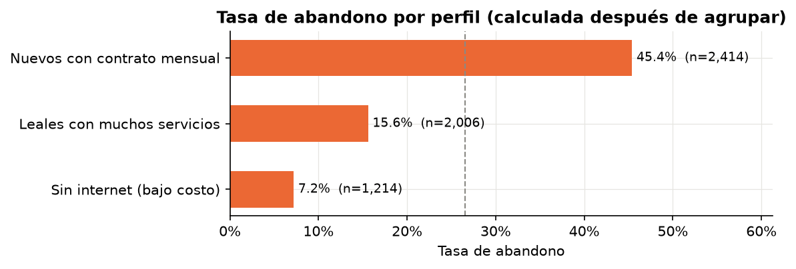
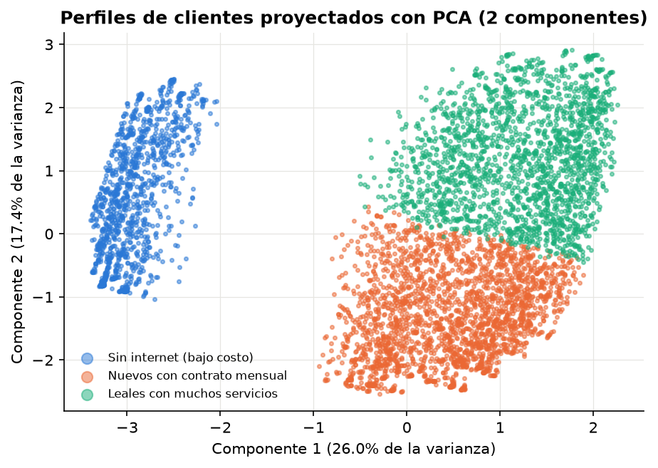
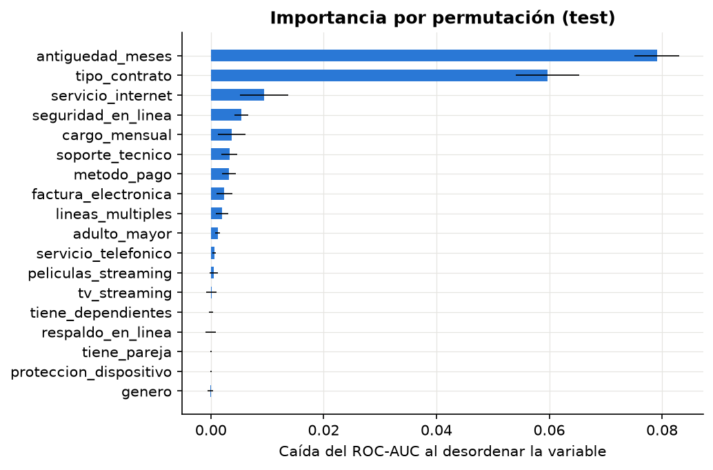
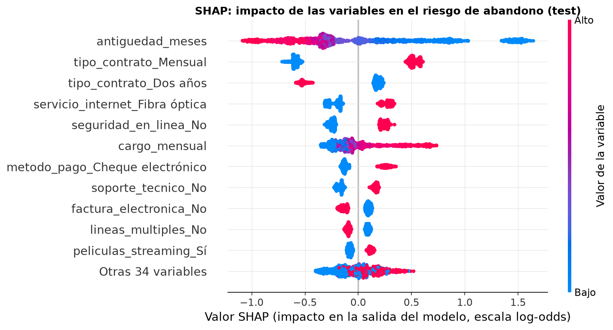
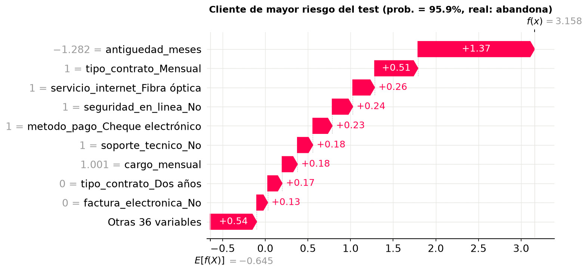
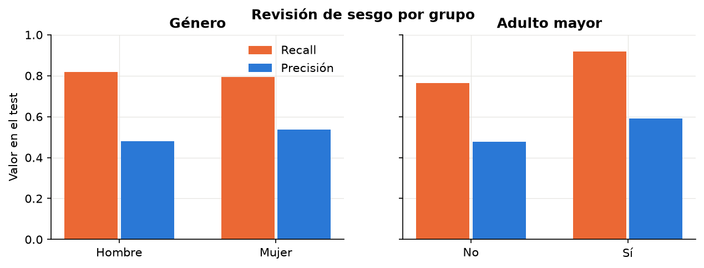

# ¿Quién se va? Alerta temprana de abandono de clientes con boosting optimizado, perfiles no supervisados e interpretación

**Práctica 2 (P2) · Artículo**

**Autores:** Leydy Mayumy Coyllo Mamani · Noe Wilber Tipo Mamani · Jose Alfonso Nina Condori
**Curso:** Machine Learning · Maestría en Ciencia de Datos e Inteligencia Artificial · Escuela de Posgrado, Universidad Nacional de Juliaca (EPG UNAJ)
**Docente:** Dr. Alain Paul Herrera Urtiaga

---

## Resumen

El abandono de clientes es una pérdida importante de ingresos para las empresas de telecomunicaciones. Este trabajo construye un sistema de alerta temprana con el dataset Telco Customer Churn de IBM (7 043 clientes, 26.5 % de abandono). Partiendo de una regresión logística L2, el mejor modelo de la P1, optimizamos LightGBM con Optuna (40 intentos) y lo comparamos con 25 particiones de validación cruzada y la prueba de Wilcoxon. El modelo optimizado mejora a su versión por defecto en los 25 folds y a la regresión logística en recall en 19 de 25 folds (+0.013; p = 0.0014): una mejora real, pero pequeña. En el test alcanza un recall de 0.805, ROC-AUC de 0.848 y PR-AUC de 0.667. Un análisis con k-means sin usar la etiqueta revela que el perfil de clientes nuevos con contrato mensual concentra el riesgo (45.4 % de abandono). Una red neuronal no los supera. La importancia por permutación y SHAP muestran que la antigüedad y el tipo de contrato dominan las predicciones; el género no influye. Las alertas son más frecuentes entre adultos mayores, en parte porque abandonan más. El modelo se entrega en una aplicación de escritorio y una demo web.

**Palabras clave:** abandono de clientes, clasificación desbalanceada, LightGBM, Optuna, prueba de Wilcoxon, k-means, SHAP, sesgo algorítmico.

## 1. Introducción

Cuando un cliente cancela su servicio, la empresa pierde todo su ingreso futuro. Si es posible identificar con anticipación a quienes están por irse, se les puede ofrecer una acción de retención (un descuento, un cambio de contrato, soporte técnico) a un costo mucho menor que el de reemplazarlos. El objetivo de este proyecto es responder: **con los datos actuales de un cliente, ¿qué clientes cancelarán su servicio?**

En la P1 analizamos los datos y comparamos cinco modelos con validación cruzada. La **regresión logística L2** fue la mejor (recall 0.793 en validación cruzada y 0.773 en el test). Este artículo continúa ese trabajo con cuatro preguntas:

1. ¿La optimización de hiperparámetros de un modelo de *boosting* mejora de forma **real** (y no por azar) al mejor modelo de la P1?
2. ¿Existen **perfiles** de clientes, descubiertos sin usar la etiqueta, que concentren el riesgo?
3. ¿Aporta una **red neuronal**?
4. ¿**Qué variables** usa el modelo final y se equivoca más con algún **grupo** de clientes?

**Trabajos relacionados y herramientas.** Usamos scikit-learn para el Pipeline, los modelos clásicos y las métricas (Pedregosa et al., 2011); LightGBM, una implementación eficiente de árboles con *gradient boosting* (Ke et al., 2017); Optuna para la búsqueda de hiperparámetros con el muestreador TPE (Akiba et al., 2019); y SHAP, que reparte cada predicción entre las variables según los valores de Shapley (Lundberg y Lee, 2017). Para comparar modelos seguimos la recomendación de usar pruebas no paramétricas como la de Wilcoxon (Wilcoxon, 1945; Demšar, 2006), con la advertencia de que en validación cruzada repetida los folds no son independientes (Nadeau y Bengio, 2003). Con una clase minoritaria, la curva precisión-recall es más informativa que la ROC (Saito y Rehmsmeier, 2015).

## 2. Datos

Dataset **Telco Customer Churn** (IBM, 2019): 7 043 clientes de una empresa de telecomunicaciones ficticia y 21 columnas (demografía, antigüedad, servicios, contrato, pago, cargos y la variable objetivo). Abandonan **1 869 clientes (26.5 %)**. Hay 11 valores faltantes en `cargo_total`, todos de clientes con 0 meses de antigüedad. Las columnas y categorías se tradujeron al español (`data/README.md`).

Se usan 18 variables: 2 numéricas (`antiguedad_meses`, `cargo_mensual`) y 16 categóricas. Se excluyen `id_cliente` (identificador) y `cargo_total`, que tiene una correlación de 0.9996 con antigüedad × cargo mensual y no mejora el modelo de forma consistente (P1).

Hallazgos principales del análisis exploratorio (P1): el abandono es de 42.7 % con contrato mensual frente a 2.8 % con contrato de dos años; 47.4 % en el primer año de antigüedad frente a 9.5 % después de cuatro años; 41.9 % con fibra óptica; 45.3 % con pago por cheque electrónico.

## 3. Método

**Partición.** 80 % entrenamiento (5 634) y 20 % test (1 409), estratificada, semilla 42. Toda la selección de modelos usa solo el entrenamiento.

**Pipeline.** Imputación (mediana / moda), escalado de numéricas y *one-hot* de categóricas dentro de un `Pipeline`, de modo que en cada fold el preprocesamiento se aprende solo con los datos de entrenamiento de ese fold (sin fuga de datos).

**Métrica.** La principal es el **recall** de la clase "abandona", porque no detectar a un cliente que se va (pierde todo su ingreso) cuesta más que una oferta de retención innecesaria. Se reportan también precisión, ROC-AUC y PR-AUC.

**Desbalance.** `class_weight="balanced"` en todos los modelos que lo admiten; pesos por muestra balanceados en la red neuronal.

**Optimización.** Optuna, 40 intentos, muestreador TPE con semilla 42, sobre LightGBM. Espacio de búsqueda: número de árboles (100–800), tasa de aprendizaje (0.005–0.2, logarítmica), hojas (4–64), profundidad (2–10), mínimo de observaciones por hoja (10–150), submuestreo de filas (0.5–1) y columnas (0.3–1), y regularización L1 y L2 (0.001–10, logarítmica). La función objetivo es el **PR-AUC** medio en validación cruzada de 5 folds. No se optimizó el recall directamente porque se puede inflar marcando a casi todos como riesgo; el recall queda determinado por los pesos y el umbral.

**Comparación.** Validación cruzada estratificada repetida (5 folds × 5 repeticiones = 25 folds, los mismos para todos los modelos) y prueba de rangos con signo de Wilcoxon sobre las diferencias fold a fold. Regla de decisión fijada de antemano: el modelo optimizado reemplaza a la regresión logística solo si gana en recall con p < 0.05 y no pierde significativamente en PR-AUC; si no, se elige el modelo más simple.

**No supervisado.** k-means (10 inicializaciones) sobre las variables transformadas del entrenamiento, **sin la etiqueta**; elección de k entre 2 y 8 con el coeficiente de silueta (Rousseeuw, 1987) y el método del codo; la tasa de abandono de cada grupo se calcula después. PCA a 2 dimensiones para visualizar.

**Red neuronal.** `MLPClassifier` con capas ocultas de 32 y 16 neuronas (ReLU), regularización L2 (α = 0.001) y *early stopping*, dentro del mismo Pipeline y con los mismos 25 folds.

**Interpretación y sesgo.** Importancia por permutación en el test (caída del ROC-AUC, 10 repeticiones); SHAP con `TreeExplainer` sobre las variables transformadas; recall, precisión y tasa de alertas por `genero` y `adulto_mayor` en el test.

## 4. Experimentos y resultados

### 4.1 Optimización con Optuna

El mejor intento (n.º 30 de 40) alcanzó un **PR-AUC de 0.671** en validación cruzada, frente a 0.646 de LightGBM por defecto. Los hiperparámetros elegidos describen un modelo muy regularizado: 600 árboles de **profundidad 2**, tasa de aprendizaje 0.019, al menos 132 observaciones por hoja y submuestreo de filas (0.63) y columnas (0.87) (`resultados/03_optuna_mejores.json`). Es decir, conviene un *boosting* "suave", cercano a un modelo aditivo, y no árboles profundos.

### 4.2 Comparación fold a fold

| Modelo (25 folds) | Recall | Precisión | ROC-AUC | PR-AUC |
|---|---|---|---|---|
| **LightGBM optimizado** | **0.809 ± 0.028** | 0.522 ± 0.016 | **0.850 ± 0.012** | **0.670 ± 0.019** |
| LightGBM original | 0.736 ± 0.030 | 0.542 ± 0.019 | 0.837 ± 0.011 | 0.649 ± 0.019 |
| Regresión logística L2 | 0.796 ± 0.027 | 0.521 ± 0.014 | 0.845 ± 0.011 | 0.657 ± 0.016 |

*Fuente: `resultados/03_resumen_comparacion.csv`.*

| Comparación | Métrica | Diferencia media | Folds ganados (A–B) | p (Wilcoxon) |
|---|---|---|---|---|
| Optimizado vs. original | Recall | +0.073 | 25–0 | < 0.0001 |
| Optimizado vs. original | PR-AUC | +0.021 | 25–0 | < 0.0001 |
| Optimizado vs. reg. logística | Recall | **+0.013** | **19–5** (1 empate) | **0.0014** |
| Optimizado vs. reg. logística | Precisión | +0.001 | 12–13 | 0.79 |
| Optimizado vs. reg. logística | ROC-AUC | +0.006 | 22–3 | < 0.0001 |
| Optimizado vs. reg. logística | PR-AUC | +0.013 | 22–3 | < 0.0001 |

*Fuente: `resultados/03_wilcoxon.csv`.*

**Lectura.** La optimización cambió de verdad a LightGBM: frente a su versión por defecto gana en recall, ROC-AUC y PR-AUC en los 25 folds (perdiendo algo de precisión). Frente a la regresión logística, la mejora es **estadísticamente significativa pero pequeña**: poco más de un punto de recall, sin diferencia en precisión. Hay dos razones para tomar el valor p con cautela: los 25 folds comparten datos entre sí (Nadeau y Bengio, 2003) y Optuna se ajustó con los mismos datos de entrenamiento, lo que favorece ligeramente al modelo optimizado. Aplicando la regla fijada de antemano, **el modelo final es LightGBM optimizado**; la regresión logística sigue siendo una alternativa razonable si se prioriza la simplicidad.

**Umbral.** Con predicciones fuera de fold, bajar el umbral de 0.5 a 0.3 sube el recall del modelo optimizado de 0.807 a 0.911, pero el porcentaje de clientes alertados pasa de 41 % a 55 % (`resultados/03_umbral.csv`). Mantenemos 0.5, porque elegir otro depende del presupuesto de retención de la empresa, un dato que no tenemos.

### 4.3 Resultado en el test

| Modelo | Recall | Precisión | ROC-AUC | PR-AUC | VP | FN | FP |
|---|---|---|---|---|---|---|---|
| Regresión logística L2 (P1) | 0.773 | 0.506 | 0.839 | 0.628 | 289 | 85 | 282 |
| **LightGBM optimizado (final)** | **0.805** | 0.508 | **0.848** | **0.667** | **301** | **73** | 292 |

*Fuentes: `resultados/02_test_mejor_modelo.json` y `resultados/modelo_final.json`.*

En el test, el modelo final detecta **301 de los 374 clientes que abandonan**, 12 más que la regresión logística, con 10 falsas alarmas más. La dirección coincide con la validación cruzada.

### 4.4 Perfiles de clientes (k-means)

La silueta es baja para todos los k (máximo 0.26 con k = 2), señal de que los clientes no forman grupos muy separados. Con k = 2 el algoritmo solo separa "con internet" de "sin internet", lo que no aporta. Elegimos **k = 3**, que es el codo de la inercia y la segunda mejor silueta (0.22) (`resultados/04_eleccion_k.csv`).

| Perfil | Clientes | % del entrenamiento | Antigüedad media (meses) | Cargo medio (USD) | % contrato mensual | **Tasa de abandono** |
|---|---|---|---|---|---|---|
| Nuevos con contrato mensual | 2 414 | 42.8 % | 14.9 | 67.7 | 90.4 % | **45.4 %** |
| Leales con muchos servicios | 2 006 | 35.6 % | 55.1 | 88.1 | 24.8 % | 15.6 % |
| Sin internet (bajo costo) | 1 214 | 21.5 % | 30.2 | 21.1 | 34.8 % | 7.2 % |

*Fuente: `resultados/04_perfiles.csv`.*

Sin usar la etiqueta para agrupar, el perfil **"nuevos con contrato mensual"** tiene una tasa de abandono de 45.4 %, 1.7 veces el promedio. Es donde conviene concentrar la retención: ofertas para pasar a contrato anual, pago automático y soporte técnico durante los primeros meses. El grupo "sin internet" aparece claramente separado en la proyección PCA (43 % de la varianza en dos componentes); los otros dos son contiguos.

### 4.5 Red neuronal

| Modelo (25 folds) | Recall | ROC-AUC | PR-AUC |
|---|---|---|---|
| Red neuronal (MLP) | 0.789 ± 0.034 | 0.838 ± 0.014 | 0.641 ± 0.020 |
| Regresión logística L2 | 0.796 ± 0.027 | 0.845 ± 0.011 | 0.657 ± 0.016 |
| LightGBM optimizado | 0.809 ± 0.028 | 0.850 ± 0.012 | 0.670 ± 0.019 |

*Fuentes: `resultados/04_red_vs_modelos.csv` y `resultados/04_wilcoxon_red.csv`.*

La red **empata** con la regresión logística en recall (−0.007; p = 0.097) pero pierde en ROC-AUC y PR-AUC, y **pierde** con LightGBM optimizado en recall (−0.020; p = 0.0012), ROC-AUC y PR-AUC. Con unas 5 600 filas y 18 variables tabulares no tiene ventaja, y es más difícil de explicar: no se adopta.

## 5. Interpretación

**Importancia por permutación (test).** El modelo depende sobre todo de **la antigüedad** (desordenarla reduce el ROC-AUC en 0.079) y del **tipo de contrato** (0.060). Muy por detrás siguen el servicio de internet (0.009), la seguridad en línea (0.005), el cargo mensual (0.004), el soporte técnico (0.003) y el método de pago (0.003). El **género no aporta nada** (−0.0001) (`resultados/05_importancia_permutacion.csv`).

**SHAP.** A nivel global, las variables con mayor impacto medio son la antigüedad (baja antigüedad = más riesgo), el contrato mensual (aumenta el riesgo) frente al de dos años (lo reduce), la fibra óptica, la falta de seguridad en línea, un cargo mensual alto, el cheque electrónico y la falta de soporte técnico (`resultados/05_shap_importancia.csv`). La dirección de cada efecto coincide con el análisis exploratorio.

**Casos individuales.** El cliente del test con mayor riesgo (probabilidad 95.9 %; sí abandonó) tiene 1 mes de antigüedad, contrato mensual, fibra óptica sin seguridad ni soporte técnico, pago con cheque electrónico y un cargo de 95.10 USD: todos los factores de riesgo a la vez. El de menor riesgo (1.4 %; no abandonó) lleva 72 meses, tiene contrato de dos años, no tiene internet, paga por transferencia automática y su cargo es de 19.55 USD (`resultados/05_casos_individuales.json`).

## 6. Ética y limitaciones

**Revisión de sesgo (test).**

| Grupo | n | Abandono real | % alertados | Recall | Precisión |
|---|---|---|---|---|---|
| Hombre | 722 | 25.1 % | 42.7 % | 0.818 | 0.481 |
| Mujer | 687 | 28.1 % | 41.5 % | 0.793 | 0.537 |
| No adulto mayor | 1 187 | 23.3 % | 37.2 % | 0.765 | 0.479 |
| Adulto mayor | 222 | 44.1 % | 68.5 % | 0.918 | 0.592 |

*Fuente: `resultados/05_sesgo.csv`.*

- **Género:** brechas pequeñas (2.5 puntos de recall, 5.6 de precisión) y tasas de alerta casi iguales. No observamos un sesgo relevante.
- **Adulto mayor:** el modelo alerta al **68.5 %** de los adultos mayores frente al 37.2 % del resto (brecha de 31 puntos). Su recall también es mayor (0.918 frente a 0.765). Parte de la diferencia refleja que su tasa real de abandono es casi el doble (44.1 % frente a 23.3 %), pero la brecha en alertas es mayor que la brecha real. El grupo es pequeño en el test (222 personas), así que las cifras son inestables.
- **Qué haríamos:** (1) usar las alertas **solo para ofrecer beneficios**, nunca para negar servicios, subir precios o tratar peor a un cliente, de modo que una alerta de más no perjudique a nadie; (2) monitorear estas métricas por grupo en cada reentrenamiento; (3) si la brecha en alertas preocupa, evaluar umbrales por grupo o retirar `adulto_mayor` del modelo y medir cuánto recall se pierde.

**Limitaciones.**

- Es un **dataset de muestra de IBM sobre una empresa ficticia**: los resultados no se pueden trasladar a una empresa real sin reentrenar y validar con sus datos.
- Es **una foto en un momento del tiempo**: no sabemos cuándo se midieron las variables respecto del abandono ni si los patrones cambian con el tiempo.
- El modelo predice **asociaciones, no causas**: que el contrato mensual se asocie al abandono no prueba que cambiar el contrato evite que el cliente se vaya; eso requiere un experimento.
- El modelo **no sabe cuánto vale cada cliente** ni el costo de cada acción, por lo que no optimiza ganancia; el umbral 0.5 debería ajustarse con el presupuesto de retención.
- La mejora sobre la regresión logística es **pequeña**, y el valor p de Wilcoxon es optimista con folds no independientes.
- Persisten las **brechas por edad** descritas arriba.
- Precisión cercana a 0.5: aproximadamente **la mitad de las alertas son falsas alarmas**.

## 7. Conclusiones

1. **La optimización con Optuna mejoró a LightGBM de forma real** frente a su versión por defecto (+0.073 de recall en 25 de 25 folds) y **superó a la regresión logística por poco** (+0.013 de recall, 19 de 25 folds, p = 0.0014). Es una mejora estadísticamente significativa, pero de magnitud modesta.
2. **Modelo final: LightGBM optimizado**, con recall de **0.805**, precisión 0.508, ROC-AUC 0.848 y PR-AUC 0.667 en el test: detecta 301 de los 374 clientes que abandonan.
3. **Sin usar la etiqueta, k-means encuentra un perfil de riesgo**: los clientes nuevos con contrato mensual (43 % de la base) abandonan el 45.4 %. Allí debe concentrarse la retención.
4. **La red neuronal no aporta**: empata con la regresión logística en recall y pierde con LightGBM optimizado.
5. **El modelo es interpretable y coherente con el negocio**: la antigüedad y el contrato dominan, seguidos de internet, servicios de protección, cargo y método de pago; el género no influye.
6. **No hay sesgo relevante por género; sí más alertas para adultos mayores**, en parte justificadas por su mayor abandono. El modelo debe usarse solo para ofrecer retención y vigilarse por grupo.
7. El modelo está disponible en una **aplicación de escritorio** (predicción individual y por lote) y en una **demo web** en Streamlit, y se reproduce con `python scripts/entrenar.py`.

## Declaración sobre el uso de herramientas de inteligencia artificial

En la elaboración de este artículo se emplearon herramientas de inteligencia artificial generativa como apoyo en la escritura de código y en la redacción de borradores. Los resultados numéricos proceden de la ejecución de los notebooks del repositorio y fueron verificados por el equipo, que asume la responsabilidad del contenido.

## Referencias

Akiba, T., Sano, S., Yanase, T., Ohta, T., & Koyama, M. (2019). Optuna: A next-generation hyperparameter optimization framework. En *Proceedings of the 25th ACM SIGKDD International Conference on Knowledge Discovery & Data Mining* (pp. 2623–2631). https://doi.org/10.1145/3292500.3330701

Demšar, J. (2006). Statistical comparisons of classifiers over multiple data sets. *Journal of Machine Learning Research, 7*, 1–30.

IBM. (2019). *Telco customer churn on ICP4D* [Repositorio de GitHub; dataset Telco-Customer-Churn.csv]. https://github.com/IBM/telco-customer-churn-on-icp4d

Ke, G., Meng, Q., Finley, T., Wang, T., Chen, W., Ma, W., Ye, Q., & Liu, T.-Y. (2017). LightGBM: A highly efficient gradient boosting decision tree. En *Advances in Neural Information Processing Systems 30* (pp. 3146–3154).

Lundberg, S. M., & Lee, S.-I. (2017). A unified approach to interpreting model predictions. En *Advances in Neural Information Processing Systems 30* (pp. 4765–4774).

Nadeau, C., & Bengio, Y. (2003). Inference for the generalization error. *Machine Learning, 52*(3), 239–281.

Pedregosa, F., Varoquaux, G., Gramfort, A., Michel, V., Thirion, B., Grisel, O., Blondel, M., Prettenhofer, P., Weiss, R., Dubourg, V., Vanderplas, J., Passos, A., Cournapeau, D., Brucher, M., Perrot, M., & Duchesnay, É. (2011). Scikit-learn: Machine learning in Python. *Journal of Machine Learning Research, 12*, 2825–2830.

Rousseeuw, P. J. (1987). Silhouettes: A graphical aid to the interpretation and validation of cluster analysis. *Journal of Computational and Applied Mathematics, 20*, 53–65. https://doi.org/10.1016/0377-0427(87)90125-7

Saito, T., & Rehmsmeier, M. (2015). The precision-recall plot is more informative than the ROC plot when evaluating binary classifiers on imbalanced datasets. *PLOS ONE, 10*(3), e0118432. https://doi.org/10.1371/journal.pone.0118432

Wilcoxon, F. (1945). Individual comparisons by ranking methods. *Biometrics Bulletin, 1*(6), 80–83. https://doi.org/10.2307/3001968
